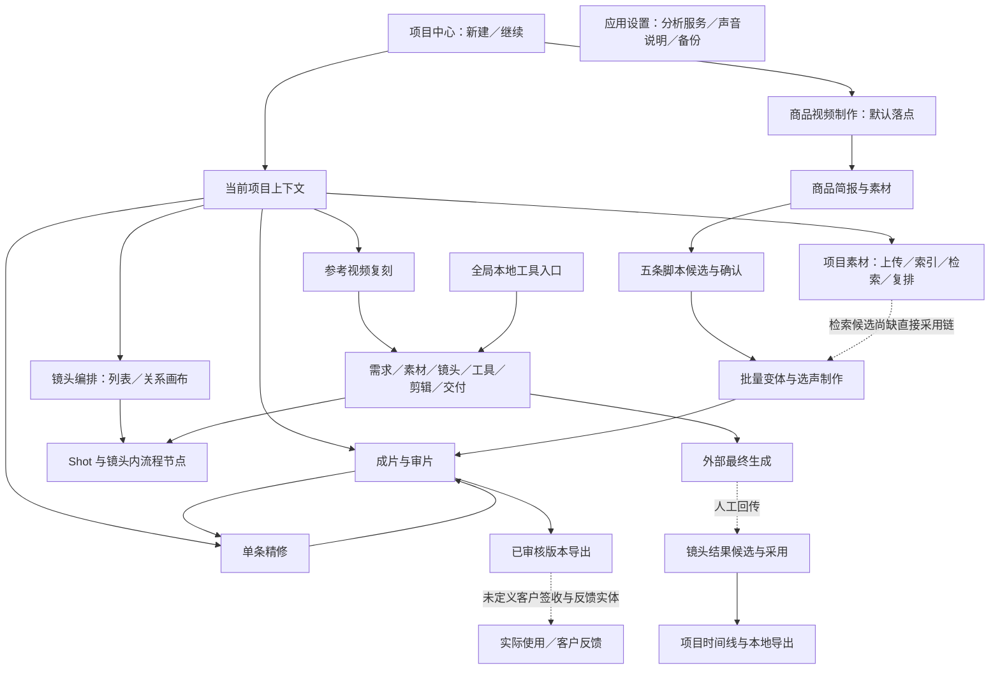
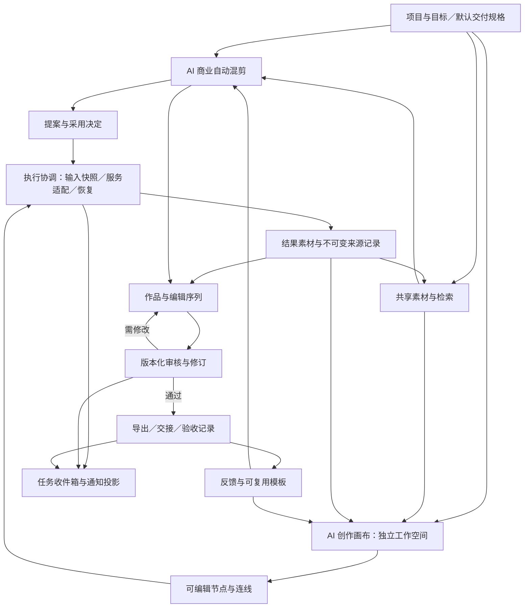

# 产品业务逻辑与模块架构审查

日期：2026-09-30。审查对象：AI Video Reverse Engineer 当前工作区（HEAD `49de22d`，包含已有未提交改动）。

## 1. 结论与审查边界

**当前项目不是完全没有业务闭环，而是“商业制作有局部闭环，项目层缺少统一业务组织，创作画布仍被旧镜头模型限制”。** 最大问题不在页面数量，而在入口、对象、状态和下一步动作没有形成一致的产品语言。

应重组为：**一个项目、两种创作方式（AI 商业自动混剪／AI 创作画布）、共享素材与运行基础、统一作品版本／审核／交付。** 参考复刻、镜头规划、深度控制与超分属于按需能力，不应要求每位用户先理解这些技术模块。

用户已明确：画布独立页面、不强制先有 Shot、多项目共同参考、成熟源码优先复用；首版应接入一条真实生成链路。这些是本报告的目标约束，不是现状能力声明。

审查方法：静态核对实际前后端入口、契约和业务状态；查阅仓库已有验收记录；联网核验外部产品官方资料。未重新运行完整生产链、未做用户访谈、未测当前模型质量或可用性。缺失判断限定于已检查入口、模型及流程，不能推导为仓库任何角落都没有相关代码。高频判断是任务频率假设，需后续埋点或观察验证。报告是改造建议，不代表实施批准、代码修改或发布。

历史内部试点已有五条确认候选、两条退回修改后批准并导出的记录；该记录明确未发生真实客户签收或商业效果验收，因此不能把项目说成“从未跑通”，也不能把内部导出成功说成商业闭环全部完成。[既有验收记录](../product-scope-freeze/evidence/06-p0-end-to-end-acceptance.md)

## 2. 当前业务模块结构图

实线表示当前可见入口或明确交接；虚线表示人工衔接或尚未形成统一产品流程。



代码依据：[全站导航](../../frontend/src/ContentStudioApp.tsx:24)、[页面协调](../../frontend/src/ContentProductionWorkspace.tsx:50)、[复刻路径](../../frontend/src/ReproductionFlow.tsx:98)、[嵌套工作台导航](../../frontend/src/PreproductionWorkspace.tsx:414)。

### 模块性质与实际职责

| 当前模块 | 用户任务 | 业务对象／输出 | 审查判断 |
|---|---|---|---|
| 项目中心 | 找到／继续工作 | Project | 有容器，缺目标、阻碍、待办和当前作品摘要 |
| 商品视频制作 | 批量做商业视频 | 简报、候选脚本、批次、变体 | 当前最接近完整任务流，应保留并升级自动编排 |
| 项目素材 | 准备可用内容 | Asset、索引、片段候选、搜索记录 | 属于共享基础；检索必须能带目标采用 |
| 镜头编排 | 管理镜头与依赖 | Shot、镜头流程投影、布局 | 是镜头视图，尚不是自由创作画布 |
| 参考视频复刻 | 分析参考并准备新内容 | 分析、镜头、控制素材、Workflow 包 | 属于专业支线，内部又暴露整套导航 |
| 单条精修 | 修正当前作品 | BatchTask 的变体、字幕与轨道 | 应从具体作品打开，顶级裸入口语义弱 |
| 成片与审片 | 判断可交付版本 | 预览、审核决定、导出记录 | 重要主模块，建议围绕作品版本集中呈现 |
| 本地工具 | 转换、裁切、超分、控制素材准备 | 技术处理产物 | 应作为素材／节点／作品的上下文动作，不是主旅程 |
| 应用设置 | 准备执行环境、恢复数据 | 分析配置、凭据引用、备份 | 应区分分析、生成、配音、渲染能力可用性 |

## 3. 角色、目标与首次使用

这里的角色是业务职责，**不表示当前已有用户账户或权限角色**。同一名本地用户可以兼任全部职责。

| 角色 | 进入系统的主要目标 | 成功结果 | 最常用的操作 | 当前障碍 |
|---|---|---|---|---|
| 商业内容运营／投放制作人 | 将商品与素材批量转为可用短视频 | 一批符合目标的已审核版本 | 素材检索、脚本确认、批量制作、审片 | 缺少交付规格与完成目标；固定五条候选；检索与采用割裂 |
| AI 视觉创作者 | 探索图片／视频创意并延续最佳结果 | 可追溯且可继续创作的素材结果 | 节点连接、生成、比较、分支续创 | 当前流程必须围绕镜头，目标生成链尚未接入 |
| 剪辑／精修人员 | 修复具体作品的节奏、画面、声音和字幕 | 可重新审核的新版本 | 定位问题、替换片段、预览差异 | 精修与时间线两个上下文，审片反馈缺少对象级定位 |
| 品牌负责人／审核人 | 判断内容是否准确、符合要求 | 对明确版本作出通过／退回决定 | 查看差异、意见、当前版本 | 有本地审核记录，但没有独立交接、责任人及外部反馈闭环 |
| 项目负责人／兼任管理员 | 看进度、解决阻碍、保障产出 | 知道哪些工作需处理、何时能交付 | 待办、失败任务、服务配置、交付清单 | 跨模块状态分散；设置以分析服务为主 |

**第一次进入应完成的最小任务**：选择“批量制作商业视频”或“自由画布创作” → 建立一个项目 → 放入第一份素材或输入一个创作目标 → 看见可执行的下一步。不要先要求了解 Shot、Workflow、节点目录或所有供应商配置。

服务可用性按用户即将执行的动作检查：选择生成时才检查生成服务，开始配音时检查音色环境。首屏提供明确的“为什么用”：批量制作可交付内容，或在画布探索并复用 AI 结果。用户无需先完成长问卷；平台、比例、时长、数量等常用规格采用可见默认值，必要时修改。

当前实际：新建只输入名称，打开／新建都 `setPage("create")`，因此所有角色先进入商品制作；项目对象主体仍保留参考媒体、预处理、深度与语义分析字段。问题是业务重心和入口不一致，不是字段本身必须立刻删除。[入口](../../frontend/src/ContentStudioApp.tsx:69)、[Project](../../backend/app/main.py:243)

## 4. 当前核心用户路径与高频能力

### 路径 A：商业制作（已有局部闭环）

商品名称／事实与素材 → 生成五条脚本 → 逐条确认 → 交接批量变体 → 选声、配音、字幕与预览 → 审核 → 退回精修或通过 → 导出已通过版本。

正面：已有显式候选交接、版本校验、旧审核失效、独立变体处理和历史。问题：这更接近“辅助制作流水线”，尚不能据此承诺从任何商业目标自动完成素材匹配与可靠成片。

### 路径 B：参考复刻（专业准备链）

参考素材 → 分析／拆镜 → 需求与控制素材准备 → 导出方案到外部生成 → 人工回传镜头结果 → 采用结果 → 剪辑与导出。外部生成原本是明确范围，不是偶发 bug；但它已无法满足新确认的画布内真实生成目标。

### 路径 C：创作画布（目标路径尚未贯通）

当前：项目 → 镜头编排 → 新建镜头 → 编辑镜头内部素材／步骤。目标：任意素材或文本 → 独立处理／生成节点 → 执行 → 结果候选 → 分支续创 → 按需进入作品／时间线。两者差异是业务模型，而不只是页面宽度。

### 高频与辅助分层

- 高频核心（待用行为数据验证）：导入／找到素材、创建内容、批量运行、看结果、替换或续创、审核、导出。
- 共用支撑：服务配置、任务恢复、版本历史、素材引用、输出规格、费用与发送披露。
- 按需专业能力：深度／人物控制、参考拆解、超分、手动 Workflow 交换、分镜规划。
- 不能把所有支撑与专业能力都铺成同级主菜单；也不能为了简化入口删除已有专业路径。

## 5. 已有成熟机制：应保留而非推倒重建

1. **业务状态从保存事实投影**，避免页面自己维护第二套“进度真相”。商业制作投影已有十种阶段，并能定位具体变体问题。[content_workflow](../../backend/app/content_workflow.py:14)
2. **执行状态不等于业务决定**。durable_runs 明确禁止运行结果直接包含 adopted／approved／delivered，并有输入快照与迟到结果保护。[durable_runs](../../backend/app/durable_runs.py:1)
3. **素材稳定身份与引用检查已有基础**，多个工作流使用统一素材服务；不要为了新画布再建一份媒体库。[ProjectAssets](../../backend/app/project_assets.py)、[引用事实](../../backend/app/asset_references.py)
4. **审核与导出有版本门禁**。脚本、字幕、画面修改后的旧预览和旧审核不会自然等同当前有效版本。[batch_production](../../backend/app/batch_production.py)
5. **AI 已部分嵌入任务**：脚本候选生成、参考语义分析、片段检索与云端复排都是任务内能力；不能误判为只有聊天入口。缺口是结果采用和下一步执行，不是缺一个聊天窗口。[脚本操作](../../frontend/src/AigcCreator.tsx:334)、[检索与复排](../../frontend/src/SegmentRetrievalPanel.tsx:139)

## 6. 主要问题与证据

优先级含义：P0 为两条主线的业务阻断或身份／状态错误；P1 为效率和跨模块体验；P2 为有实际需求后的规模化能力。不是安全漏洞等级。

| ID | 触发场景与当前事实 | 用户后果／根因 | 建议 | 级别 |
|---|---|---|---|---|
| B01 | 自由创作者新建项目仍进入商品制作；没有任务模式入口 | 用户不知道画布与商业制作的关系，首次路径偏向单一角色 | 新建／继续按目标与最近工作恢复；项目概览呈现下一步 | P0 |
| B02 | 一级菜单并列项目素材、制作、镜头、精修、审片；复刻内部再有需求／素材／镜头／工具／剪辑／批量／交付 | 同级菜单混合对象、阶段与工具；“我该在哪处理这个作品”不清楚 | 双创作入口＋共享素材＋作品中心；精修成为作品动作 | P0 |
| B03 | workflow 由 Shot 投影，process 必需 ownerShotId，SaveWorkspace 不接收独立图 | 无法直接从文本或素材建立独立生成流程 | 独立创作图持久化；Shot 只作可选关联，不复制素材 | P0 |
| B04 | 既有最终生成端点被 410 策略关闭 | 新目标“节点真实生成—返回结果—续创”无法完成 | 为创作画布新增受控真实生成路径；不要不加区分恢复全部旧接口 | P0 |
| B05 | 片段索引和视觉检索可预览／复排，但组件没有选择目标作品并采用片段的动作 | 找到合适画面仍需人工重建剪辑信息，AI 结果成为独立展示 | 从脚本段／画布调用检索，明确目标，把 Asset ID＋入出点写入草稿 | P0 |
| B06 | “按脚本推荐镜头”使用素材名称／备注分词匹配，视觉检索在另一条路径 | 用户以为自动看懂了素材；重复录入备注；优质片段未参与编排 | 统一候选采用契约；标签规则作为可解释回退，不能冒充视觉语义编排 | P0 |
| B07 | 商业制作确认判定硬编码最新候选五条全部确认 | 一条内容、部分先做或非商品创作被固定批次约束 | 允许选择要制作的候选与数量；五条保留为预设，不作为领域不变量 | P1 |
| B08 | 项目进度只投影 AIGC＋Batch，未覆盖画布、复刻、索引和通用运行 | 同一项目多条线并行时摘要不代表全部工作；无法看全局阻碍 | 项目概览聚合分支状态和待办，不用一个总 stage 覆盖所有工作流 | P0 |
| B09 | 各模块有自己的运行、错误和历史，但导航无统一任务／待处理入口 | 切页后用户不知道后台完成、失败或需要确认，依赖记忆回查 | 聚合既有 Run，提供任务收件箱、来源定位、去重通知 | P0 最小版／P1 完善 |
| B10 | 商品简报与复刻需求分别保存比例、时长、风格等，缺明确共享／覆盖关系 | 跨路径转用内容时可能重复录入或采用不同规格 | 项目默认规格＋作品／节点显式覆盖，保留业务专属简报 | P1 |
| B11 | 商业变体编辑与复刻 Timeline 分属不同对象上下文 | “进入剪辑”可能进入另一份序列；画布结果到作品缺明确交接 | 统一进入编辑器的定位契约，保留不同序列实体，显式创建／加入作品 | P0 接口／P1 UI |
| B12 | 有审核原因和历史，但未见统一到时间点／片段／节点的反馈定位 | 审核人说“这段不对”，编辑者需重新寻找；反馈可能落在旧版本 | ReviewDecision 锁定版本，Comment 定位到对象／时间点，退回生成修订任务 | P1 |
| B13 | content_workflow 的 delivered 来自当前有效导出，不记录客户收到、签收或投放效果 | “已交付”易被理解为商业完成 | 区分导出就绪／已交接／已验收，先支持手动记录，不急于平台集成 | P1 |
| B14 | 项目卡只有名称和更新时间；任务摘要、交付目标、下次动作缺失 | 最近更新不等于当前优先级，用户打开后仍要重新判断 | 展示待审、失败、运行中、下一步及最近作品；不新增伪进度百分比 | P1 |
| B15 | 全局“本地工具”实际依赖当前项目，且堆叠参考输入、分析、控制、超分等模块 | 技术能力暴露成用户必选步骤；工具结果去向不明确 | 素材／节点上下文动作＋专业工具抽屉；每次处理明确产物与来源 | P1 |
| B16 | 界面页和选中项目保存在 React 状态，主路径缺稳定实体 URL | 难以从待办返回具体失败节点、分享内部定位或刷新恢复操作位置 | 项目／画布／作品／运行的可恢复路由；分享权限另行决定 | P1 |

### 关键代码证据定位

- B01/B14/B16：[ContentStudioApp](../../frontend/src/ContentStudioApp.tsx:36)，创建与打开：69–73；项目卡：108。
- B02/B11/B15：[ContentProductionWorkspace](../../frontend/src/ContentProductionWorkspace.tsx:50)，[PreproductionWorkspace](../../frontend/src/PreproductionWorkspace.tsx:414)，[工具堆叠](../../frontend/src/ContentStudioApp.tsx:78)。
- B03：[WorkflowNode](../../frontend/src/preproductionApi.ts:74)、[保存契约](../../backend/app/preproduction_api.py:126)、[Shot 投影](../../backend/app/preproduction_api.py:986)。布局持久化已存在，不能沿用旧研究称其“完全未保存”。
- B04：[禁用策略](../../backend/app/final_generation_policy.py:5)、[复刻最终生成入口](../../backend/app/reproduction_api.py:253)。
- B05：[索引候选说明与操作](../../frontend/src/SourceSegmentIndexPanel.tsx:128)、[检索结果操作](../../frontend/src/SegmentRetrievalPanel.tsx:161)。这里“候选可以人工采用”的文案不能替代实际采用动作。
- B06：[推荐算法](../../backend/app/batch_recommendation.py:28)。
- B07/B08：[五条候选与活动批次选择](../../backend/app/content_workflow.py:163)、[投影读取的数据源](../../backend/app/content_workflow_api.py:20)。
- B10：[复刻需求字段](../../frontend/src/PreproductionWorkspace.tsx:420)、[商品简报](../../frontend/src/AigcCreator.tsx:269)。
- B13：[阶段判定](../../backend/app/content_workflow.py:121)。导出是技术交付的一种完成事实，不应直接等同客户验收。

## 7. 合并、拆分与保留

| 调整 | 推荐处理 | 不应误做 |
|---|---|---|
| 合并审片、成片列表、交付历史的产品入口 | 形成“作品中心”，按待审／需修改／可交付／历史筛选 | 不把媒体版本、审核决定、导出运行揉成一个可变状态字段 |
| 合并素材入口与检索入口 | 一个项目素材库，可从画布、脚本或作品带目标打开 | 不再复制素材文件／素材身份；不是把检索分数当采用决定 |
| 合并多个任务展示 | 统一任务收件箱聚合已有运行记录，链接回源对象 | 不立即替换全部执行器或重写队列基础设施 |
| 从镜头工作台拆出创作画布 | 独立页面与独立图模型，图中对象可关联 Shot | 不把旧 Shot 数据强行改成所有节点的新容器 |
| 从画布编辑拆出运行与结果事实 | 图定义可编辑，运行锁定输入快照，结果是持久 Asset／结果版本 | 不让“连线改了”自动改写历史血缘或已导出成片 |
| 从全局导航拆出精修动作 | 在作品上“修改这条”，打开同一作品的编辑上下文 | 不删除专业时间线能力，也不要求两种序列立即共用一个庞大编辑器 |
| 从参考复刻拆出工具能力 | 参考分析为可选起点，深度／超分等为可复用操作 | 不把专业参考路径强塞给普通商业制作用户 |
| 保留双创作方式 | 商业自动流程与自由画布共享底层对象，可相互交接 | 不强迫批量制作用户学习节点连线，也不强迫画布用户确认五条脚本 |

## 8. 推荐的新业务闭环

### 商业自动混剪闭环

创作目标与交付规格 → 导入／复用素材 → 索引与检索 → AI 提案（脚本＋片段匹配＋编排） → 用户确认或局部调整 → 批量执行配音／字幕／渲染 → 作品审查 → 退回形成针对性修订 → 通过并导出 → 记录交接与反馈 → 将有效素材、模板和决策复用于下一批。

每一步回答四件事：当前对象是什么；是否有结果；为什么阻塞；可以执行什么动作。AI 先产生可编辑提案，不隐式覆盖人工修改；外部发送与费用范围变化时重新披露，不用重复确认每个无副作用的本地动作。

### AI 创作画布闭环

独立画布 → 拖入图片／视频／音频或创建文本 → 添加并连接处理／生成节点 → 校验输入与服务 → 提交真实运行 → 显示进度、失败或结果未知 → 保存结果素材与血缘 → 比较并选择结果 → 从选定结果分支续创 → 按需组织 Shot／加入作品或时间线 → 审核与交付。

用户画的依赖边与历史生成血缘必须分开：连线定义下一次怎么运行，运行快照记录这次实际用了什么。选中旧结果继续创作应引用那一版结果，不能在上游更新后静默替换。

### 跨模块交接契约

| 来源 → 目标 | 必须携带 | 用户可见结果 |
|---|---|---|
| 检索 → 脚本段／作品草稿 | assetId、源文件有效版本、入出点、目标 ID、采用理由 | 看见采用的画面与段落；可撤销、可替换 |
| 画布结果 → 素材库 | 结果 assetId、runId、输入快照引用、来源节点 | 素材库立即可找到，可追溯生成来源 |
| 画布结果 → 剪辑／作品 | 结果 assetId、版本、目标序列或新作品意图 | 明确加入哪条作品，返回可定位同一片段 |
| 审片退回 → 修订 | 作品版本、意见、对象／时间点定位 | 编辑者打开具体问题，修改形成新版本 |
| 导出 → 交付记录 | 作品版本、审核依据、输出文件、目标接收方（可选） | 区分文件就绪、已交接和已验收 |
| 任意运行 → 待处理中心 | 源对象、状态、阻碍原因、允许动作 | 一键回到来源处理，不复制业务状态 |

## 9. 优化后的模块架构与数据关系



**数据所有权建议**：

- Project：创作目标、默认规格与工作上下文；不拥有一份复制的所有模块状态。
- Asset：媒体事实及可用版本；画布节点、镜头与片段引用它。当前 ProjectAssets 优先延用。
- CanvasDocument／Node／Edge：独立可编辑创作图。Shot 关联可选。画布布局是呈现数据，不决定镜头顺序或播放顺序。
- Run：实际输入快照、执行器、运行状态、结果与错误；优先沿用 durable_runs 约定，具体供应商另有适配。
- Result／Lineage：结果素材及其真实来源；人工采用与生成完成分开。结果身份尽量基于现有 Asset 与运行记录，避免再建无必要媒体副本。
- Work／Version：用户要交付的一条内容及版本；这是产品侧统一身份，实施时可先用现有 BatchTask／variant 或 Timeline 作适配，不要求立即迁移所有存储。
- ReviewDecision：针对作品版本的判断；执行成功不能自动批准。
- DeliveryRecord：导出包及交接／验收事实；投放成效可延后。
- InboxItem／Activity：从业务事件聚合的行动入口；不是另一套状态真相。

“统一作品中心”并不等于所有内容共享一份万能 JSON。应统一身份、交接与定位协议，保留不同创作方式的深层实现。对外接口应围绕“采用候选、提交运行、修订作品、审核版本”等完整业务动作，而不是让 UI 跨模块拼装多次低级字段修改。

## 10. 状态机与自动化补齐

不能用一个 project.status 同时表示运行、内容和审核。

| 状态维度 | 推荐状态与关键规则 | 当前基础／增量 |
|---|---|---|
| 素材可用性 | 可用／处理中／缺失／需重建；旧索引不能冒充当前 | 已有素材与索引有效性，补统一可见性 |
| 提案／候选 | 草稿 → 待确认 → 已采用；修改来源后标记需复核 | 脚本已有，扩展检索与画布结果采用 |
| 执行 | 校验／提交／排队／运行 → 成功／失败／取消；外部结果未知单列 | durable_runs 已有核心约定；未知结果先核对，不能盲目重试导致重复费用 |
| 结果 | 可用／被引用／源输入已变化（历史仍保留） | 保存来源，变更不覆盖旧结果 |
| 作品版本 | 草稿 → 预览就绪 → 待审 → 通过／退回 → 新修订 | 商业变体已有基础，统一映射其他来源 |
| 交付 | 导出处理中 → 文件就绪 → 已交接 → 已验收／需返修 | 现有导出可复用；后半段属于新业务事实 |
| 项目概览 | 活动分支＋待办＋阻碍＋完成目标 | 多维汇总，用户明确选择归档，不按某一次导出自动结束项目 |

最低自动化机制：

1. 运行成功注册结果与来源，发一次站内完成事件，提供“查看／继续创作／加入作品”。
2. 运行失败生成可定位的待处理项，说明是否可重试与会不会重新收费；重试是新的 attempt，不能改写旧记录。
3. 来源变更标记受影响下游，并提供“只重跑受影响分支”，不自动覆盖人工采用。
4. 审核退回生成对应版本修订任务；新版本再次待审，旧决定保留。
5. 导出就绪提供文件和交接动作；“下载过”不自动推断“客户已验收”。
6. 恢复／重启后聚合未完成工作；优先复用已有恢复能力，不为此先建设完整微服务事件总线。

AI／Agent 应拥有明确任务、工具与产物：例如“为这段脚本找画面”“生成三个可比较候选”“重排这条作品”“修复这项审核意见”。产物必须成为提案、运行、素材或作品版本，能预览、采用、撤销、重试和追溯。可以提供对话，但对话不是成果存储，也不能绕过版本和审批契约。

## 11. 优化后的导航与页面结构

```text
全局
├─ 项目
├─ 待处理／任务（失败、待确认、待审、已完成）
└─ 设置（分析／生成／配音／渲染能力、存储与备份）

项目
├─ 概览（目标、当前工作、阻碍、下一步）
├─ AI 商业自动混剪
├─ AI 创作画布 → 独立工作空间
├─ 素材（检索、引用、来源与历史）
└─ 作品（草稿、待审、需修改、可交付、历史）
   └─ 作品详情 → 精修／审核／导出／反馈

画布内
├─ 顶部：返回项目、画布名称、保存状态、运行入口
├─ 左侧：添加素材／文本／处理与生成节点
├─ 中央：画布、连接、分组、候选与结果
├─ 右侧按需：当前对象属性／运行与结果详情
└─ 角落：缩放、适配、视图控制
```

参考复刻保留为“从参考开始”的模板／专业工作流入口，可在项目概览和添加菜单打开。工具进入上下文动作与高级面板。首轮迁移保留旧入口跳转和草稿恢复，不能先删页面再让用户寻找数据。

主路径建议支持可恢复的实体路由，如项目／画布／作品／运行定位；具体 URL 方案在实施中确定。项目内“返回”恢复原对象和视口，切换创作方式不清空草稿。

## 12. 补充发现：局部修订、历史与恢复

### B17：单条候选修订扩大为整批重建（P0）

触发：五条候选已交接，用户回到脚本修改其中一条、重新确认并交接。当前交接键包含全部候选 revision；已有成功子任务只有 revision 全匹配才复用，否则创建新的父任务与五个子任务。未改的四条也会成为新批次对象，旧批次的配音、预览与审核仍保留，但不会自动成为新批次的有效结果。

这是“保存历史”与“用户可理解的修订”之间的差距。建议明确两个动作：**修订这一条**（新作品版本，复用未受影响产物）与**另做一批**（显式新批次）。不能默认修订一条等于重做全部。[交接实现](../../backend/app/batch_production.py:308)

### B18：重生成候选令旧工作从主进度消失（P0）

触发：旧批次已进入制作，用户修改简报或生成新候选但尚未完成确认。投影只取最新 generation，并按当前 brief revision、候选 revision 找 activeBatchId；旧批次仍在 BatchEditor 的任务列表，但主向导可能回到简报／脚本阶段。

建议把“正在探索的新提案”和“正在生产的已采用批次”分开。项目可以同时有多个有效工作分支；选择当前工作应是显式用户动作或稳定业务关联，不能只靠数组最后一组推断。[候选组选择](../../backend/app/content_workflow.py:59)、[活动批次匹配](../../backend/app/content_workflow.py:169)

### B19：配音要求没有成为明确的交付规格（P1，需产品选择）

当前 `_voice_is_current` 把 absent 视为可接受，因此无配音内容也可能生成预览、审核并导出。这对纯画面视频可以是正确行为，不应简单判为 bug。建议在交付规格明确“需要配音／无需配音”，只在需要时作为门禁；若页面承诺有声成片而规格未定义，用户无法判断缺音是故意还是遗漏。[声音有效性](../../backend/app/batch_production.py:63)

### B20：可恢复记录不等于自动续跑（P1）

本地任务重启后，排队／运行中的配音、预览、字幕识别和导出被标为失败，提示重新提交。已有记录和失败恢复语义，不能说“没有任务历史”；但也不能宣传无人工介入的自动续跑。优先补清晰的中断待办与安全批量重试，再按实际规模考虑自动续跑和并发，不要求立即替换单 worker。[恢复逻辑](../../backend/app/batch_editing_api.py:586)、[执行契约](../../backend/app/durable_runs.py:157)

## 13. 对标优秀产品：借业务机制，不复制行业名词

以下为官方资料的简要归纳；“本项目应用”是审查建议。更完整证据与许可边界见 [对标研究](../../docs/research/product-logic-benchmarks-2026-09-30.md)。这些参考不能代替媒体生成项目的源码核查。

| 对标对象 | 业务机制 | 本项目的具体应用 | 不照搬 |
|---|---|---|---|
| HubSpot | 营销活动 brief 关联内容资产；工作流使用明确触发与入组规则 | 商业目标和商品事实贯穿脚本、变体与成片；修改配置不静默重新生产 | 联系人、交易、邮件营销整套模型 |
| Linear | Project 聚合成果，Issue 承载行动，View 只是视图；Triage 对请求做处理 | 项目概览聚合待补素材、待审、失败任务；统一对象身份、多种筛选视图 | 软件研发周期和多层工单体系 |
| n8n | Workflow 定义与 Execution 分离；重试明确使用哪个版本与输入 | 画布编辑不污染历史执行；重跑原快照和按当前图重跑是不同动作 | 所有通用 SaaS 集成节点和完整运行平台 |
| Dify | 草稿、版本、运行日志与人工输入各有职责 | 节点级错误定位、结果采用、人工等待与继续执行 | 把 AI 应用“发布”混同视频作品“交付” |
| ComfyUI | 提交、队列、进度、历史结果与节点能力查询分离 | 第一条真实媒体生成适配保存外部运行 ID，只有真实结果可用才完成 | 用外部队列状态代替业务审核状态 |
| Greenhouse（ATS） | 同一对象页聚合评价、活动、任务与批准；评价证据不同于签核 | 作品详情集中预览、质检、时码意见、审核、版本和交付 | 招聘阶段、统一候选人打分或强制复杂多级审批 |

一手来源：[HubSpot 活动与资产](https://knowledge.hubspot.com/campaigns/create-campaigns-using-marketing-studio)、[Linear 概念模型](https://linear.app/docs/conceptual-model)、[n8n 执行与重试](https://docs.n8n.io/workflows/executions/all-executions/)、[Dify 版本](https://docs.dify.ai/en/cloud/use-dify/build/version-control)、[Dify 人工输入](https://docs.dify.ai/en/cloud/use-dify/nodes/human-input)、[ComfyUI 路由](https://docs.comfy.org/development/comfyui-server/comms_routes)、[Greenhouse 对象详情](https://support.greenhouse.io/hc/en-us/articles/30352015432987-Candidate-profile-redesign-overview)、[Greenhouse 批准](https://support.greenhouse.io/hc/en-us/articles/17679895458587-Approvals-overview)。

画布专项继续多项目共同取材：Toonflow／basketikun 关注节点创作与结果续创，BeatDesign 关注素材引用与血缘，tldraw／AFFiNE／Excalidraw 关注操作空间与直接编辑，ComfyStudio 关注 Workflow 映射，OpenStory／Huobao 关注可选的叙事一致性，XYFlow 继续作为底座。旧研究中禁止独立创作的范围结论不再适用；每个拟复制文件重新核查固定版本、许可、依赖和实际运行路径，不能因为参考项目可运行就认为适配后也已跑通。

源码复用原则：先寻找可直接运行的模块、组件和流程，允许且适配时复制或集成，保留来源声明；只写项目数据、执行服务、版本与交付契约所需适配。技术栈或许可证不允许时明确说明，不为“复用”硬引入另一套项目、凭据、任务和素材系统。本轮只研究，未复制竞品代码。

## 14. 缺失能力与业务流程清单

### 当前必须补的能力

- 项目概览／下一步：跨创作方式显示当前工作、阻碍与动作。
- 独立创作图与真实生成：节点身份、保存、执行、结果、分支、失效及继续创作。
- 检索与采用：目标作品／脚本段／节点定位，片段采用、替换和撤销。
- 统一作品身份与版本视图：明确哪一条内容被修改、审核和交付。
- 最小任务收件箱：聚合运行失败、待确认、待审和完成事件，能回到源对象。

### 重要但后续分阶段补齐

- 可复用品牌／商品事实与输出规格，减少跨项目重复录入。
- 时码与对象级反馈、修订对比、交接／签收记录。
- 批次模板、画布模板／子流程、局部重跑与成本记录。
- 基于真实需求的协作：负责人、审片链接、访问控制与到期提醒。
- 商业效果回流：先手工关联投放记录，证实价值后再接平台数据。

### 不建议作为这轮 P0

多租户计费、CRM 联系人系统、招聘式审批层级、通用聊天平台、插件市场、任意外部 SaaS 自动化、多人实时协同、完整微服务拆分。这些不能替代两条核心生产路径。成熟产品首先体现任务和对象关系清楚，而非拥有最多基础设施。

### 当前断点应被补成的流程

1. 搜索到片段 → 指定目标采用 → 预览采用效果 → 修改版本 → 审核，而非止于排序结果。
2. 文本／素材 → 真实生成 → 结果素材 → 选择一个候选续创 → 输出作品，而非止于保存图。
3. 退回某条 → 定位问题 → 只修订这条 → 重用未受影响产物 → 再审，而非隐式重建整批。
4. 后台失败／重启 → 收件箱提醒 → 回到源对象 → 明确语义重试，而非逐页查错误。
5. 导出文件 → 交接记录 → 验收／返修 → 沉淀有效模板，而非把技术导出当商业成功。

## 15. P0／P1／P2 改造优先级及验收

P0 不意味着一次重写全站。按可完成的纵向业务切片推进；两条创作主线共享对象契约，但无需相互等待全部界面重做。

| 优先级／顺序 | 改造项 | 依赖 | 可验收结果 |
|---|---|---|---|
| P0-1 | 明确项目、素材、图、运行、作品版本与审核的身份和交接规则；以现有存储作适配 | 无 | 两种创作方式使用相同 assetId；历史快照不可变；旧项目可打开，规则冲突有显式迁移决定 |
| P0-2A | 打通“检索候选 → 目标作品／脚本段采用 → 有效预览” | P0-1 | 用户不用手填片段入出点；采用可撤销；失效素材被明确拦截；结果走既有审核／导出 |
| P0-2B | 独立画布＋一条真实媒体生成链＋结果续创 | P0-1 | 从零 Shot 开始；输入→生成→实际媒体→选结果继续生成→收入素材／作品；失败和未知结果可处理 |
| P0-3 | 修订单条与新建整批分开，活动批次不随最新候选隐式消失 | P0-1 | 修订一条不复制另四条；新提案与旧生产批次并存且可定位；旧审核不被误用 |
| P0-4 | 项目目标入口、下一步摘要、最小运行待办和作品归集 | P0-2A／2B 的任一真实路径 | 首次用户选路径能产出一个有效结果；切页后能找到失败任务／待审作品；可恢复到具体对象 |
| P1 | 精修变为作品上下文；检索、素材工具和参考起点整合 | 稳定交接规则 | 无需重新选择项目和目标；编辑完成回到原作品，草稿不丢 |
| P1 | 项目默认规格／无声规则／候选数量与局部采用 | 商业链稳定 | 可只做一条或选定多条；必要声音、比例、时长按规格检查；覆盖关系可见 |
| P1 | 反馈定位、交接／签收、跨模块历史、通知去重 | 稳定版本与作品身份 | 每条意见锁定版本；导出就绪不等同客户验收；同一失败不重复通知 |
| P1 | 模板、受影响分支重跑、服务能力与费用可见 | 真实执行链 | 用户看懂重跑内容与可能费用；原结果保留，失败重试不重复生成已完成分支 |
| P2 | 协作审批、客户分享、权限与责任分工 | 出现多人／外部客户需求 | 对象访问和审批责任清楚；无需把本地单人用户强制变成团队 |
| P2 | 投放反馈回流、自动优化建议、跨项目素材与品牌资产复用 | 有真实商业数据和复用需求 | 能追溯建议来源和效果；人工确认后再执行，不自动把相关性当因果 |
| P2 | 大规模队列、多执行器、并发与多人协作优化 | 真实负载证据 | 用失败率、等待时长与任务量验证收益，不提前架构升级 |

### 每个交付切片必须附带的验收场景

- 新用户选择任一主线，完成一次有价值输出，并能指出下一步。
- 商业批次含成功和失败条目：只重试失败条目，成功条目的版本、审核和文件不变。
- 单条候选修订与重新生成整批的结果可明确区分；旧批次始终可找到。
- 画布内用真实服务生成媒体，从指定旧结果分支续创；运行时改草稿不污染在途快照。
- 采用素材进入作品后修改来源，系统指出受影响版本并要求相应复核；保留旧审核历史。
- 审核人退回具体时间点／对象，编辑者能直接定位，修订后重新审核。
- 中断与重启后记录可解释、可回到任务，区分可重试与外部结果未知。
- 桌面画布用有素材、有节点、有分支的项目验收；空态、失败态与窄屏查看另检，不能代替主场景。

### 建议观测的业务指标（不虚构当前基线）

首次有效结果耗时、首条通过版本耗时、每条通过作品的人工操作次数、片段推荐采用率、返修次数、任务失败后恢复成功率、重复执行费用、导出到交接完成率。比较改造前后的同类任务；画布节点数量、页面数和测试数量不作为产品价值指标。

## 16. 审查范围与证据限制

本轮覆盖核心导航、商业制作、素材／索引／检索、镜头画布、参考复刻、编辑、审核交付、运行和服务设置的业务接口；没有逐行安全审计所有底层媒体处理，也没有新增生产功能或执行付费生成。

代码事实已由两条独立阅读路径交叉核对；外部对标基于官方文档，不推测闭源产品内部数据库。此前 50 项 UI／工作区测试以及历史商业试点只作为既有证据，不是本轮重跑结果。项目工作区包含并行未提交工作，行号随后续实现可能变化；以链接文件中的函数和组件名为准。

**建议的改造原则：保留已经可靠的媒体、版本、审核与执行基础，重做围绕用户目标的入口、跨模块交接及画布对象关系。** 这是业务结构调整，不是更换导航名称或继续堆叠独立页面。
